# 🍲 Portal Wisata Kuliner Kota Makassar (*Anging Mammiri*)

<div align="center">


**Implementasi Web Interaktif & Wireframe Responsif 1:1 dari 14 Artboard Figma**  
Disusun oleh: **Muhammad Bintang** (`NIM: 20232205029`) • Mata Kuliah **Rekayasa Web**

</div>

---

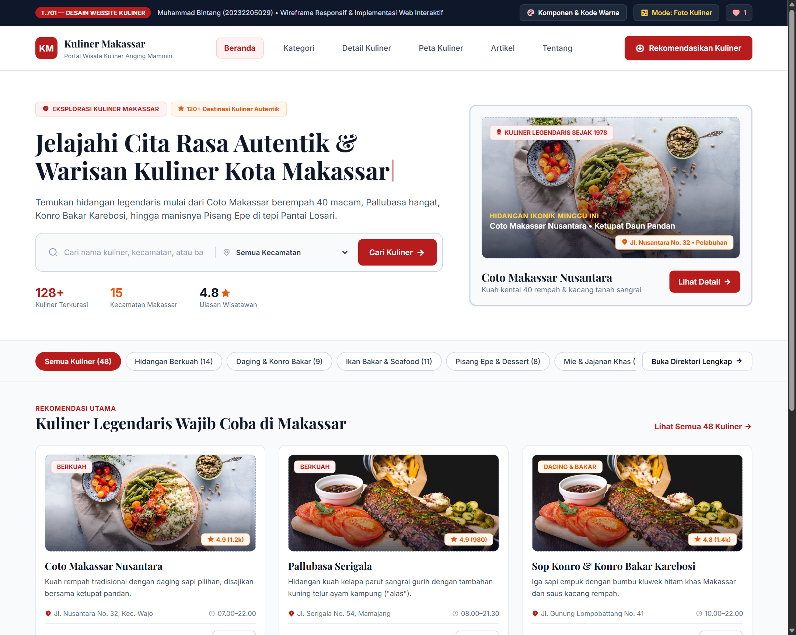

---

## 📋 Daftar Isi

1. [Tentang Proyek](#-tentang-proyek)
2. [Identitas Pengembang](#-identitas-pengembang)
3. [Penjelasan Lengkap Setiap Halaman Website](#-penjelasan-lengkap-setiap-halaman-website)
   - [00. Panel Design System, Komponen & Kode Warna](#00-panel-design-system-komponen--kode-warna)
   - [01. Halaman Beranda (Eksplorasi Utama)](#01-halaman-beranda-eksplorasi-utama)
   - [02. Halaman Kategori & Direktori Kuliner](#02-halaman-kategori--direktori-kuliner)
   - [03. Halaman Detail Kuliner & Mini-Map](#03-halaman-detail-kuliner--mini-map)
   - [04. Halaman Peta Kuliner Interaktif (Leaflet.js)](#04-halaman-peta-kuliner-interaktif-leafletjs)
   - [05. Halaman Artikel & Cerita Budaya Kuliner](#05-halaman-artikel--cerita-budaya-kuliner)
   - [06. Halaman Tentang & Formulir Rekomendasi Komunitas](#06-halaman-tentang--formulir-rekomendasi-komunitas)
   - [07. Navigasi Mobile & Burger Menu Drawer](#07-navigasi-mobile--burger-menu-drawer)
4. [Arsitektur & Struktur Direktori Modular](#-arsitektur--struktur-direktori-modular)
5. [Teknologi yang Digunakan](#-teknologi-yang-digunakan)
6. [Cara Menjalankan Proyek](#-cara-menjalankan-proyek)

---

## 🎯 Tentang Proyek

**Portal Wisata Kuliner Kota Makassar** adalah aplikasi web direktori dan pemetaan interaktif (*Single-Page Application* berbasis modular JavaScript & jQuery) yang mendokumentasikan kekayaan kuliner legendaris dan UMKM autentik di **15 Kecamatan Kota Makassar**, Sulawesi Selatan — mulai dari *Coto Makassar Nusantara*, *Pallubasa Serigala*, *Sop Konro Karebosi*, *Pisang Epe Pantai Losari*, hingga *Mie Titi Panakkukang*.

Website ini dibangun berdasarkan **14 artboard desain Figma** (tersimpan pada folder [`reference/`](reference/)) yang mencakup tampilan **Desktop & Tablet (`1440px`)** serta **Mobile (`390px`)**, lengkap dengan fitur fungsional penuh:
- **Pencarian & Multi-Filter Real-Time** berdasarkan kata kunci, kategori hidangan, kecamatan, rentang harga, dan pengurutan populer/harga/ulasan.
- **Peta GIS Interaktif Leaflet.js** dengan *Custom Pill Marker*, *Interactive Popup Card*, *Multi-Layer Switcher* (Peta Jalan, OpenStreetMap HOT, Esri Vector, Citra Satelit), dan animasi *Fly-To* koordinat asli di Kota Makassar.
- **Mode Inspeksi Wireframe vs Foto Asli** untuk membandingkan tata letak *low/high-fidelity wireframe* dengan tampilan foto kuliner secara langsung.
- **Arsitektur Modular Tanpa Build Step** yang dapat dijalankan langsung melalui klik dua kali (`file:///`) maupun melalui server HTTP lokal tanpa kendala *CORS* atau *broken map tiles*.

---

## 👨‍💻 Identitas Pengembang

| Atribut | Keterangan |
| :--- | :--- |
| **Nama Mahasiswa** | **Muhammad Bintang** |
| **NIM** | `20232205029` |
| **Kode Tugas** | `T.701 — Desain Website Kuliner` (UTS Rekayasa Web) |
| **Topik Portal** | Portal Wisata & Direktori Kuliner Kota Makassar (*Anging Mammiri*) |

---

## 🖥️ Penjelasan Lengkap Setiap Halaman Website

Berikut adalah dokumentasi visual dan penjelasan fungsional dari setiap halaman/menu yang ada pada website, baik pada layar **Desktop & Tablet** maupun **Mobile (Handphone)**.

---

### 00. Panel Design System, Komponen & Kode Warna

Panel ini dapat dibuka kapan saja melalui tombol **"Komponen & Kode Warna"** pada *Top Utility Bar*. Bagian ini mendokumentasikan fondasi visual sistem desain portal sebelum masuk ke halaman utama.

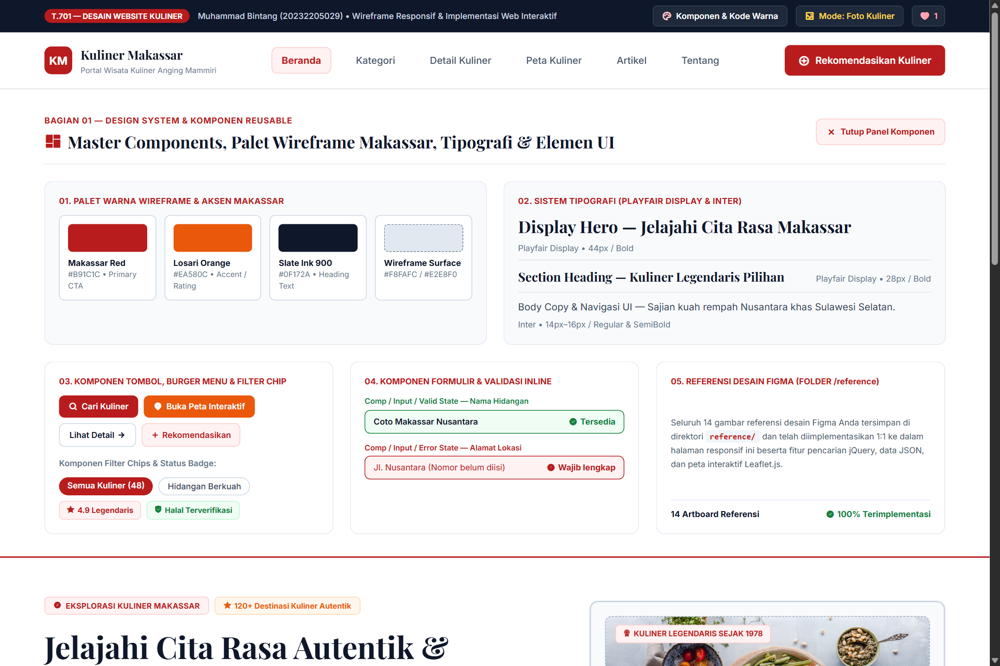

#### Fitur & Elemen Utama:
1. **Palet Warna Wireframe & Aksen Makassar (`01`)**:
   - **Makassar Red (`#B91C1C`)**: Warna aksen utama untuk tombol CTA, penanda aktif, dan identitas kuliner berempah Makassar.
   - **Losari Orange (`#EA580C`)**: Warna aksen kedua untuk indikator rating bintang, jam operasional, dan sorotan senja Pantai Losari.
   - **Slate Ink 900 (`#0F172A`)**: Warna tipografi judul utama dan kontras kartu gelap.
   - **Wireframe Surface (`#F8FAFC` / `#E2E8F0`)**: Warna latar belakang halaman dan *media placeholder frame*.
2. **Sistem Tipografi (`02`)**:
   - **Playfair Display (`Bold 700`)**: Digunakan pada judul hero, tajuk bagian (*Section Heading*), dan nama kuliner untuk memberi kesan editorial & warisan budaya.
   - **Inter (`400`, `500`, `600`, `700`)**: Digunakan pada navigasi, label filter, harga, dan deskripsi agar mudah dibaca di berbagai ukuran layar.
3. **Komponen Tombol, Filter Chip & Status Badge (`03`)**: Menampilkan variasi tombol utama, sekunder, chip kategori, dan lencana *Halal Terverifikasi* (`#15803D`).
4. **Komponen Formulir & Validasi Inline (`04`)**: Menampilkan perbandingan visual antara input berstatus **Valid (`Hijau`)** dan **Error/Wajib Lengkap (`Merah`)**.
5. **Mode Sakelar Foto Kuliner vs Wireframe Figma**: Tombol di *Top Utility Bar* untuk mengubah seluruh foto menjadi tampilan *grayscale wireframe placeholder* sesuai kanvas Figma.

---

### 01. Halaman Beranda (Eksplorasi Utama)

Halaman **Beranda** merupakan pintu masuk utama pengunjung untuk mencari kuliner dengan cepat, melihat statistik destinasi kuliner Makassar, serta menjelajahi 6 kuliner ikonik pilihan.

| Tampilan Desktop (`1440px`) | Tampilan Mobile (`390px`) |
| :---: | :---: |
|  | 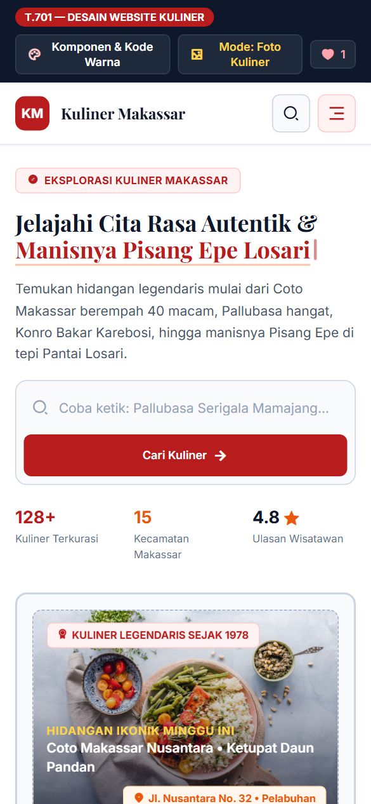 |

#### Fitur & Penjelasan Bagian:
- **Hero Section & Animasi Typewriter**:
  - Menampilkan judul utama dengan efek ketikan dinamis (*"Warisan Kuliner Kota Makassar"*, *"40 Rempah Coto Makassar"*, *"Gurihnya Pallubasa & Konro"*, *"Manisnya Pisang Epe Losari"*).
  - Kartu *Hero Visual Showcase* di sisi kanan menampilkan foto hidangan utama lengkap dengan informasi lokasi, jam buka, dan tombol pintas **"Buka Peta Kuliner"**.
- **Bilah Pencarian Cepat & Filter Kecamatan**:
  - Input pencarian instan dengan *animated placeholder* yang terhubung langsung ke filter kartu kuliner dan halaman Direktori.
  - Dropdown pemilihan cepat kecamatan (*Kec. Wajo*, *Kec. Ujung Pandang / Losari*, *Kec. Panakkukang*, *Kec. Mamajang*, *Kec. Mariso*).
- **Animasi Penghitung Metrik (*Metric Counters*)**:
  - Menampilkan statistik **`128+` Kuliner Terdata**, **`15` Kecamatan Makassar**, dan **`4.8 ★` Rating Rata-rata**.
- **Baris Chip Kategori Cepat & Grid 6 Kuliner Legendaris**:
  - Memungkinkan pengguna memfilter kartu unggulan di Beranda berdasarkan kategori (*Semua Kuliner*, *Hidangan Berkuah*, *Daging & Konro Bakar*, *Ikan Bakar & Seafood*, *Pisang Epe & Dessert*, *Mie & Jajanan Khas*).
  - Setiap kartu menampilkan foto hidangan, badge kategori, rating & jumlah ulasan, deskripsi singkat, alamat, jam buka, harga mulai per porsi, dan tombol **Detail →**.

---

### 02. Halaman Kategori & Direktori Kuliner

Halaman **Kategori & Direktori** menyediakan katalog lengkap seluruh destinasi kuliner Makassar dengan sistem penyaringan (*multi-faceted filtering*) dan pengurutan yang komprehensif.

| Tampilan Desktop (`1440px`) | Tampilan Mobile (`390px`) |
| :---: | :---: |
| 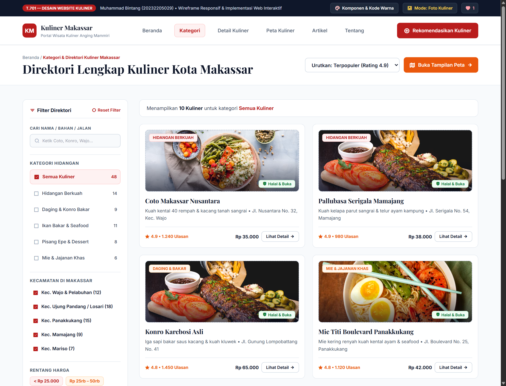 | 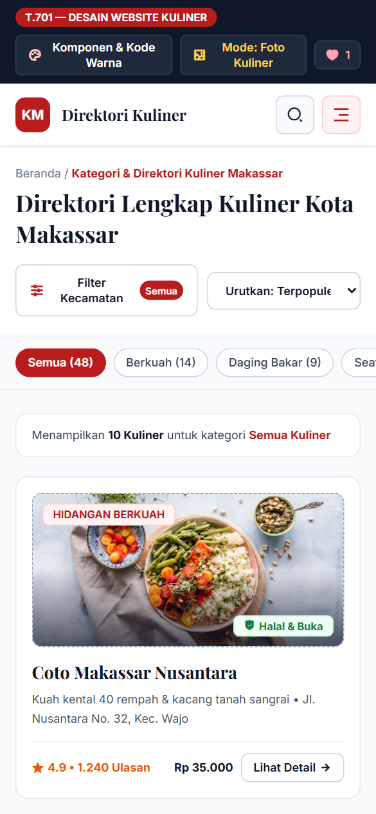 |

#### Fitur & Penjelasan Bagian:
- **Header Direktori & Dropdown Pengurutan**:
  - Dilengkapi *breadcrumb* navigasi, tombol pintas menuju tampilan Peta, serta pengurutan hasil berdasarkan:
    1. *Terpopuler (Rating Tertinggi)*
    2. *Harga Terendah (Termurah)*
    3. *Harga Tertinggi*
    4. *Ulasan Terbanyak*
    5. *Nama Kuliner (A–Z)*
- **Sidebar Filter Direktori (4 Parameter Sekaligus)**:
  1. **Cari Nama / Bahan / Jalan**: Filter teks *real-time* saat pengguna mengetik.
  2. **Kategori Hidangan**: Pilihan kategori lengkap dengan jumlah item di setiap kategori.
  3. **Kecamatan di Makassar**: *Multi-checkbox* untuk memilih satu atau beberapa kecamatan sekaligus.
  4. **Rentang Harga**: Tombol filter harga `< Rp 25.000`, `Rp 25rb – 50rb`, dan `> Rp 50.000`.
- **Status Bar & Tag Filter Aktif (*Removable Filter Tags*)**:
  - Menampilkan jumlah kuliner yang cocok dengan kombinasi filter serta *chip tag* aktif yang dapat dihapus satu per satu atau di-reset sekaligus dengan tombol **Reset Filter**.
- **Responsivitas Mobile**:
  - Pada layar HP, filter kategori berubah menjadi *horizontal scrollable chips* dan sidebar filter dapat dibuka/tutup melalui tombol **Filter**.

---

### 03. Halaman Detail Kuliner & Mini-Map

Halaman **Detail Kuliner** menyajikan informasi mendalam mengenai satu destinasi kuliner, mulai dari sejarah, komposisi bahan & rempah, galeri foto, ulasan pengunjung, hingga titik lokasi pada peta mini.

| Tampilan Desktop (`1440px`) | Tampilan Mobile (`390px`) |
| :---: | :---: |
| 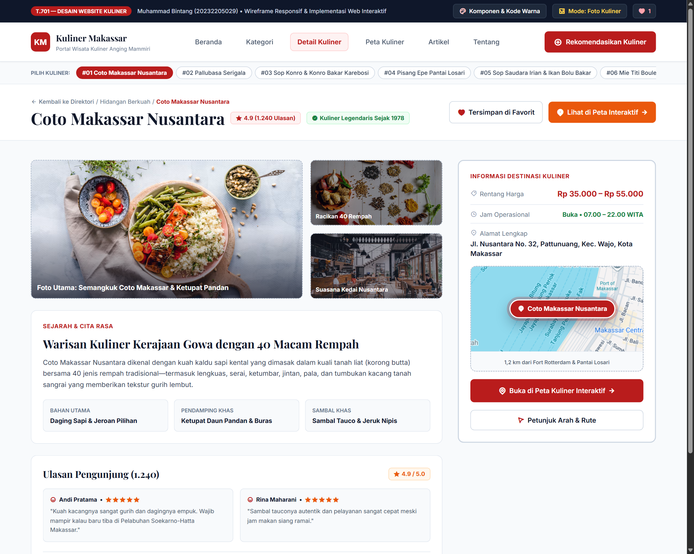 | 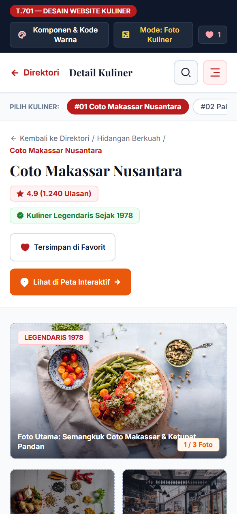 |

#### Fitur & Penjelasan Bagian:
- **Quick Switcher Bar (`#01` – `#10`)**:
  - Baris tombol di bagian atas untuk berpindah antar 10 destinasi kuliner secara instan tanpa harus kembali ke halaman direktori.
- **Galeri Foto Interaktif 3-Frame**:
  - Menampilkan 1 foto utama berukuran besar dan 2 foto sekunder (sajian pendamping & suasana warung). Pengguna dapat **mengklik foto sekunder untuk menukar (*swap*) tampilan dengan foto utama**.
- **Sejarah, Filosofi & 3 Kotak Komposisi Hidangan**:
  - Menjelaskan latar belakang sejarah warung dan rincian **Bahan Utama**, **Pendamping Khas** (seperti Ketupat Daun Pandan / Burasa), serta **Sambal Khas** (Tauco Pedas & Jeruk Nipis).
- **Ulasan Pengunjung & Formulir Tambah Ulasan Baru**:
  - Menampilkan daftar ulasan wisatawan dan warga lokal, dilengkapi formulir interaktif di mana pengguna dapat menulis nama dan komentar ulasan baru yang langsung menambah jumlah ulasan secara *real-time*.
- **Kartu Informasi Destinasi & Leaflet Mini-Map**:
  - Panel kanan berisi kisaran harga per porsi, jam operasional WITA, alamat lengkap, sertifikasi Halal, serta **Peta Mini Leaflet.js** interaktif lengkap dengan tombol **"Lihat di Peta Kuliner"** dan **"Petunjuk Arah (Google Maps)"**.
- **Simpan ke Favorit**:
  - Tombol hati untuk menyimpan kuliner ke daftar favorit yang otomatis memperbarui penghitung favorit pada *Top Utility Bar*.

---

### 04. Halaman Peta Kuliner Interaktif (Leaflet.js)

Halaman **Peta Kuliner** mengintegrasikan pustaka GIS **Leaflet.js** untuk memetakan seluruh titik koordinat kuliner di Kota Makassar secara visual dan interaktif.

| Tampilan Desktop (`1440px`) | Tampilan Mobile (`390px`) |
| :---: | :---: |
| 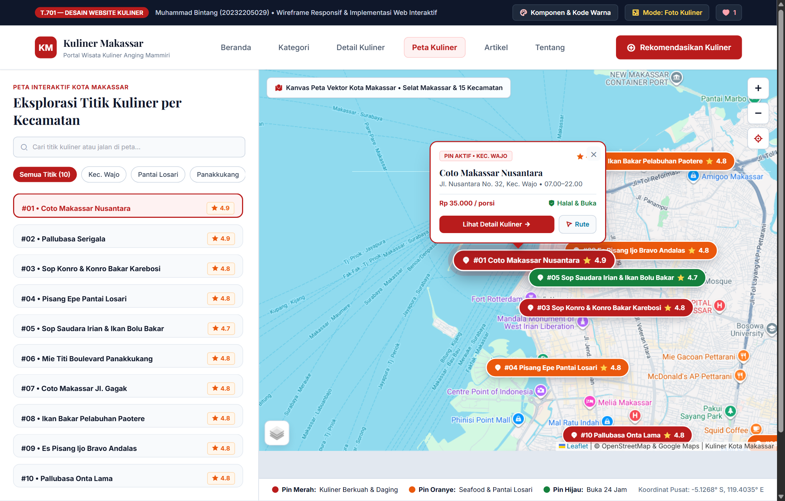 | 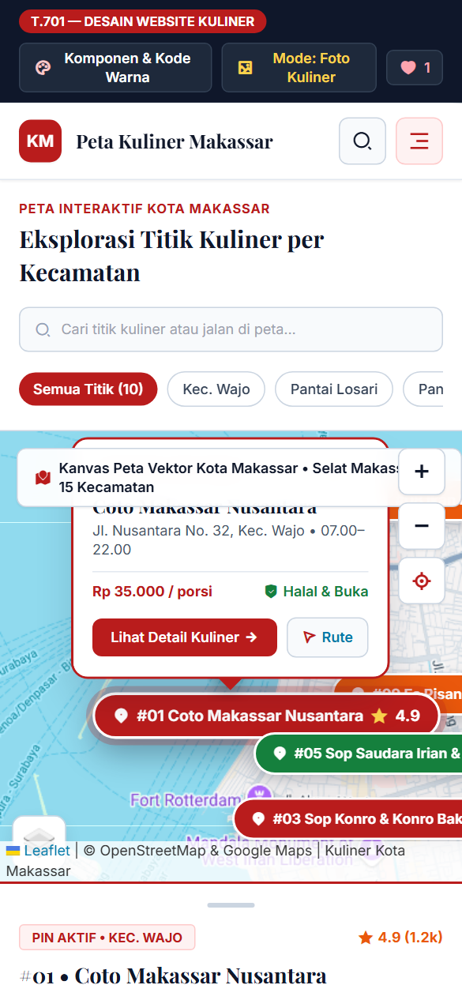 |

#### Fitur & Penjelasan Bagian:
- **Panel Daftar Titik Lokasi & Filter Chip Kecamatan (Kiri)**:
  - Dilengkapi kolom pencarian jalan/nama tempat dan chip filter area: **Semua Titik**, **Kec. Wajo**, **Pantai Losari**, **Panakkukang**, **Mamajang**, serta filter khusus **Buka 24 Jam**.
  - Mengklik salah satu kartu di daftar kiri akan menggerakkan kamera peta (*smooth `flyTo` animation*) menuju koordinat kuliner tersebut dan membuka *Popup Card*-nya.
- **Kanvas Peta Interaktif Leaflet.js (Kanan)**:
  - **Custom Pill Marker**: Pin kustom berbentuk kapsul berwarna (*Merah Makassar*, *Oranye Losari*, *Hijau Halal*) yang menampilkan nomor urut, nama kuliner, dan rating bintang, lengkap dengan efek *pulse ring* pada pin yang sedang aktif.
  - **Multi-Layer Base Map Switcher**: Kontrol di pojok kiri bawah peta untuk mengganti tampilan peta dasar:
    1. *Peta Jalan Makassar (Utama — Google Street Tiles)*
    2. *OpenStreetMap (OSM HOT)*
    3. *Peta Vektor (Esri World Street Map)*
    4. *Citra Satelit Makassar (Esri World Imagery)*
  - **Dukungan `file:///` & Automatic Tile Fallback**: Menggunakan *tile provider* yang mendukung protokol lokal tanpa blokir *HTTP Referer*, sehingga peta tetap tampil tajam meski `index.html` dibuka langsung dari File Explorer.
  - **Kontrol Zoom Kustom & Indikator Koordinat**: Tombol Zoom In (`+`), Zoom Out (`-`), Reset Pusat Kota Makassar (`-5.1477° S, 119.4327° E`), dan pembacaan koordinat pusat peta secara *live* saat peta digeser.
- **Mobile Bottom Sheet Card**:
  - Pada tampilan mobile, informasi pin yang sedang dipilih ditampilkan dalam kartu *Bottom Sheet* di bawah peta dengan tombol cepat **Lihat Detail Kuliner** dan **Petunjuk Rute**.

---

### 05. Halaman Artikel & Cerita Budaya Kuliner

Halaman **Artikel** menyajikan tulisan editorial mengenai sejarah, filosofi rempah, hingga panduan rute berburu kuliner 24 jam di Kota Makassar.

| Tampilan Desktop (`1440px`) | Tampilan Mobile (`390px`) |
| :---: | :---: |
| 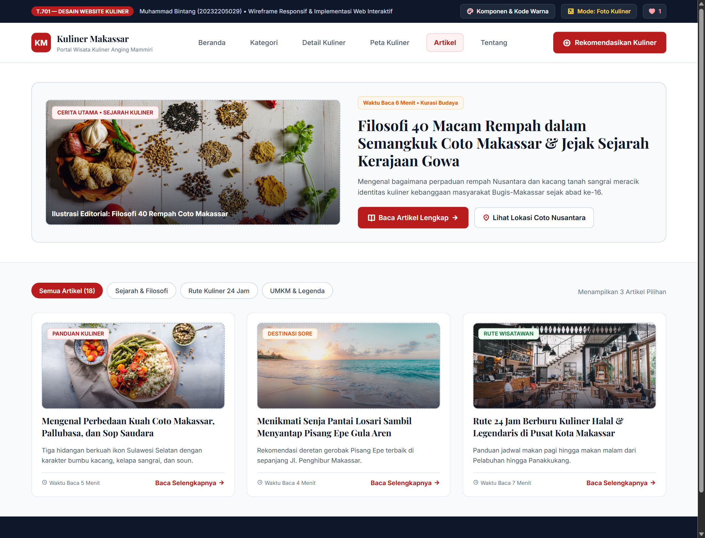 | 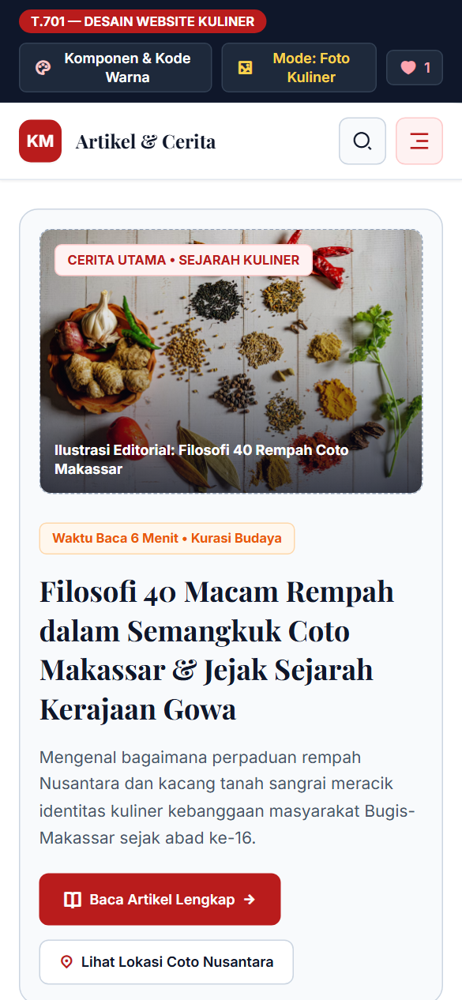 |

#### Fitur & Penjelasan Bagian:
- **Featured Hero Story Card**:
  - Menampilkan artikel utama *"Filosofi 40 Macam Rempah dalam Semangkuk Coto Makassar & Jejak Sejarah Kerajaan Gowa"* dengan waktu baca, ringkasan budaya, tombol **Baca Artikel Lengkap**, dan pintasan **Lihat Lokasi Coto Nusantara**.
- **Filter Topik Artikel**:
  - Menyaring daftar artikel berdasarkan topik: *Semua Artikel*, *Sejarah & Filosofi*, *Rute Kuliner 24 Jam*, serta *UMKM & Legenda*.
- **Modal Pembaca Artikel Lengkap (*Article Reader Modal*)**:
  - Mengklik tombol **Baca Selengkapnya →** pada kartu artikel mana pun akan membuka jendela modal pembaca artikel lengkap beserta tautan langsung menuju halaman **Detail Kuliner Terkait**.

---

### 06. Halaman Tentang & Formulir Rekomendasi Komunitas

Halaman **Tentang** memuat visi dokumentasi kuliner UMKM Kota Makassar, profil desainer, serta formulir kontribusi bagi masyarakat untuk merekomendasikan warung kuliner baru.

| Tampilan Desktop (`1440px`) | Tampilan Mobile (`390px`) |
| :---: | :---: |
| 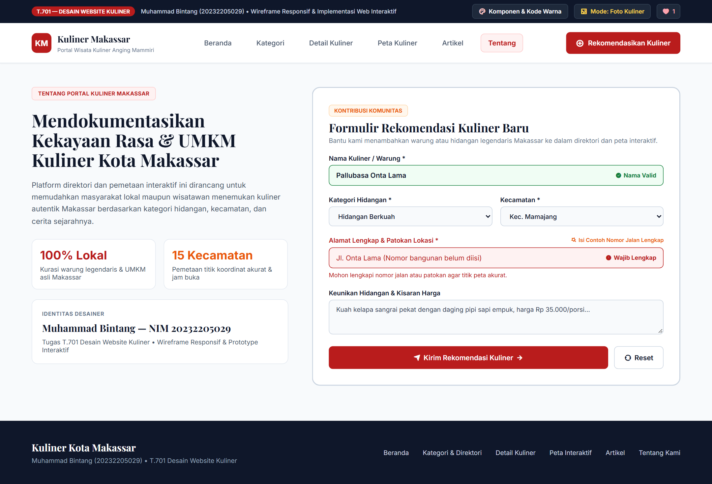 | 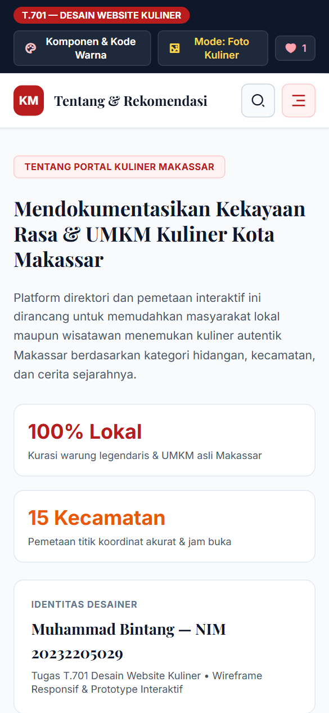 |

#### Fitur & Penjelasan Bagian:
- **Profil Portal & Identitas Desainer (Kiri)**:
  - Menjelaskan cakupan kurasi **100% Lokal** di **15 Kecamatan Kota Makassar** serta kartu identitas **Muhammad Bintang — NIM 20232205029** (`Tugas T.701 Desain Website Kuliner`).
- **Formulir Rekomendasi Kuliner Baru dengan Validasi Inline Real-Time (Kanan)**:
  - Mengimplementasikan spesifikasi *Valid State* & *Error State* dari desain Figma:
    - **Nama Kuliner / Warung**: Menampilkan indikator hijau **`✓ Nama Valid`** jika terisi minimal 3 karakter.
    - **Alamat Lengkap & Patokan Lokasi**: Menampilkan status peringatan merah **`! Wajib Lengkap`** jika nomor bangunan atau patokan lokasi belum diisi, dan otomatis berubah menjadi hijau **`✓ Alamat Lengkap`** ketika alamat dilengkapi (tersedia juga tombol bantu *"Isi Contoh Nomor Jalan Lengkap"*).
  - **Integrasi Langsung ke Direktori & Peta**: Saat formulir dikirim, kuliner yang direkomendasikan **langsung ditambahkan secara dinamis ke halaman Beranda, Direktori, dan menjadi Pin Baru di Peta Leaflet.js**.

---

### 07. Navigasi Mobile & Burger Menu Drawer

Pada perangkat *smartphone*, navigasi utama dirancang mengikuti artboard **Burger Menu Mobile (`M-Drawer`)** agar tetap ergonomis dan informatif.

<div align="center">

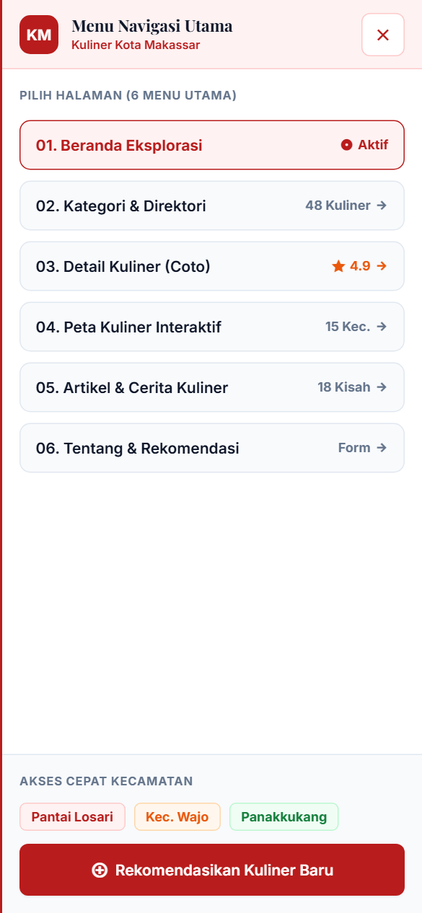

</div>

#### Fitur & Penjelasan Bagian:
- **Dynamic Context Header**: Judul pada navbar mobile otomatis menyesuaikan halaman yang sedang dibuka (*"Kuliner Makassar"*, *"Direktori Kuliner"*, *"Detail Kuliner"*, *"Peta Kuliner Makassar"*, *"Artikel & Cerita"*, *"Tentang & Rekomendasi"*), dilengkapi tombol kembali (`←`) saat berada di halaman Detail.
- **Slide-Over Burger Drawer**:
  - Menampilkan daftar 6 menu utama dengan indikator **`● Aktif`** berwarna merah pada halaman yang sedang dibuka serta informasi ringkas di setiap menu (*48 Kuliner*, *★ 4.9*, *15 Kec.*, *18 Kisah*).
  - **Filter Cepat Kecamatan**: Pintasan satu sentuhan di dalam menu burger untuk langsung membuka daftar kuliner di *Kec. Wajo*, *Pantai Losari*, *Panakkukang*, atau *Mamajang*.
  - **CTA Rekomendasikan Kuliner & Footer Identitas**: Tombol aksi cepat menuju formulir rekomendasi komunitas.

---

## 📂 Arsitektur & Struktur Direktori Modular

Seluruh kode CSS dan JavaScript telah dipecah ke dalam modul-modul terpisah berdasarkan tanggung jawabnya (*Separation of Concerns*) agar mudah dipelihara dan dikembangkan:

```text
uts-rekayasa-web/
├── index.html                          # Halaman utama aplikasi (6 Section + Drawer + Modal)
├── README.md                           # Dokumentasi lengkap proyek & penjelasan setiap halaman
├── data/
│   └── kuliner-makassar.json           # Basis data JSON (10 kuliner lengkap, 5 kecamatan, artikel)
├── assets/
│   ├── css/
│   │   ├── style.css                   # Entry point CSS (mengimpor seluruh modul CSS)
│   │   └── modules/
│   │       ├── _variables.css          # Variabel CSS (Design Tokens, warna Makassar, font)
│   │       ├── _typography.css         # Aturan font Playfair Display & Inter, custom scrollbar
│   │       ├── _components.css         # Frame foto/wireframe, efek kartu, shimmer & ripple
│   │       ├── _navigation.css         # Animasi garis bawah navbar & drawer navigasi
│   │       ├── _map.css                # Styling pin kapsul Leaflet.js, pulse ring & popup card
│   │       └── _animations.css         # Keyframes typewriter, fade-in section & stagger card
│   ├── js/
│   │   ├── app.js                      # Entry point JS: inisialisasi aplikasi & event binding
│   │   └── modules/
│   │       ├── state.js                # State terpusat aplikasi, data fallback & helper badge
│   │       ├── toast.js                # Notifikasi Toast mengambang & penghitung favorit
│   │       ├── navigation.js           # Perpindahan halaman (SPA), burger drawer & map refresh
│   │       ├── beranda.js              # Efek typewriter hero, animasi counter & kartu beranda
│   │       ├── directory.js            # Logika multi-filter direktori, sorting & active tags
│   │       ├── detail.js               # Render detail kuliner, swap galeri & mini-map Leaflet
│   │       ├── map.js                  # Peta utama Leaflet.js, multi-layer tiles, pin & popup
│   │       ├── articles.js             # Grid artikel budaya, filter topik & modal pembaca
│   │       └── recommendation.js       # Validasi inline real-time form rekomendasi kuliner baru
│   └── screenshots/                    # Hasil tangkapan layar website (Desktop & Mobile)
│       ├── 00-design-system-desktop.png
│       ├── 01-beranda-desktop.png
│       ├── 01-beranda-mobile.png
│       ├── 02-kategori-desktop.png
│       ├── 02-kategori-mobile.png
│       ├── 03-detail-desktop.png
│       ├── 03-detail-mobile.png
│       ├── 04-peta-desktop.png
│       ├── 04-peta-mobile.png
│       ├── 05-artikel-desktop.png
│       ├── 05-artikel-mobile.png
│       ├── 06-tentang-desktop.png
│       ├── 06-tentang-mobile.png
│       └── 07-burger-menu-mobile.png
└── reference/                          # 14 Artboard desain asli Figma (Desktop & Mobile)
```

---

## 🛠️ Teknologi yang Digunakan

- **HTML5 Semantik**: Struktur halaman terorganisir (`header`, `nav`, `main`, `section`, `article`, `aside`, `footer`).
- **Tailwind CSS (CDN) & Modular CSS3**: Konfigurasi palet warna kustom (`makassarRed`, `losariOrange`, `halalGreen`, `slateInk`) yang dipadukan dengan 6 modul CSS terpisah di `assets/css/modules/`.
- **jQuery 3.7.1 & Modular JavaScript (IIFE Namespace)**: Manipulasi DOM reaktif, *event delegation*, pencarian dan penyaringan instan yang terbagi dalam 9 modul di `assets/js/modules/`.
- **Leaflet.js 1.9.4**: Pustaka peta interaktif sumber terbuka dengan *multi-provider tile layers* (Google Street, OpenStreetMap HOT, Esri Street, Esri Satellite).
- **Remix Icon 4.2 & Google Fonts**: Ikonografi tajam dan pasangan tipografi *Playfair Display* + *Inter*.

---

## 🚀 Cara Menjalankan Proyek

Proyek ini dirancang agar **100% kompatibel** baik dibuka secara langsung dari File Explorer (`file:///`) maupun melalui *local web server* (`http://`):

### Cara 1 — Buka Langsung Tanpa Server (`file:///`)
1. Buka folder proyek di komputer Anda.
2. Klik dua kali file **`index.html`** untuk membukanya di browser (Google Chrome, Microsoft Edge, atau Firefox).
3. Seluruh modul JavaScript, data kuliner, maupun peta interaktif **Leaflet.js** akan langsung berjalan tanpa error CORS.

### Cara 2 — Menggunakan Live Server (VS Code / HTTP Server)
1. Buka folder proyek menggunakan **Visual Studio Code**.
2. Klik kanan pada `index.html` lalu pilih **"Open with Live Server"** (atau jalankan `npx serve .` di terminal).
3. Aplikasi akan memuat basis data eksternal dari `data/kuliner-makassar.json` melalui protokol HTTP.

---

<div align="center">

**Kuliner Kota Makassar — Portal Wisata Kuliner Anging Mammiri**  
Dibuat dengan ❤️ oleh **Muhammad Bintang (`20232205029`)** • Tugas `T.701` Rekayasa Web

</div>
